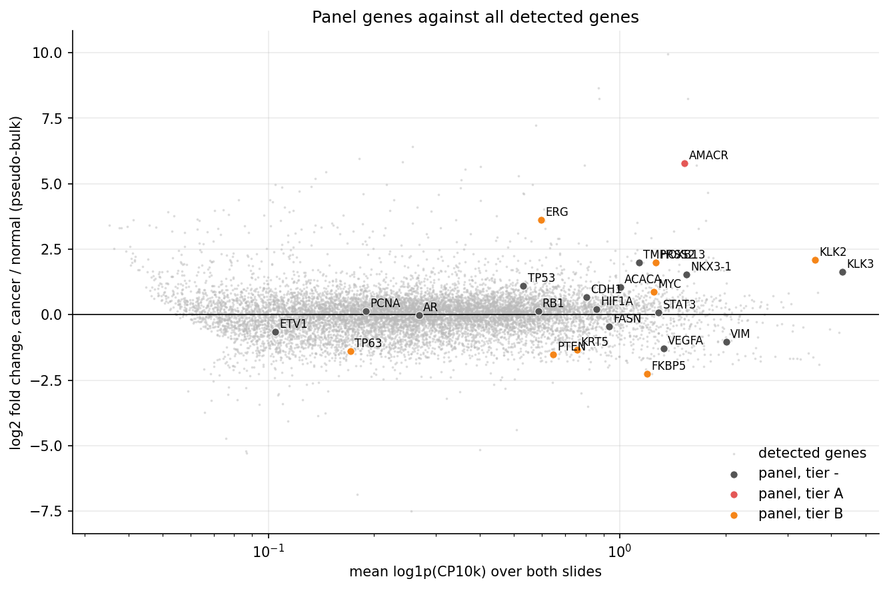
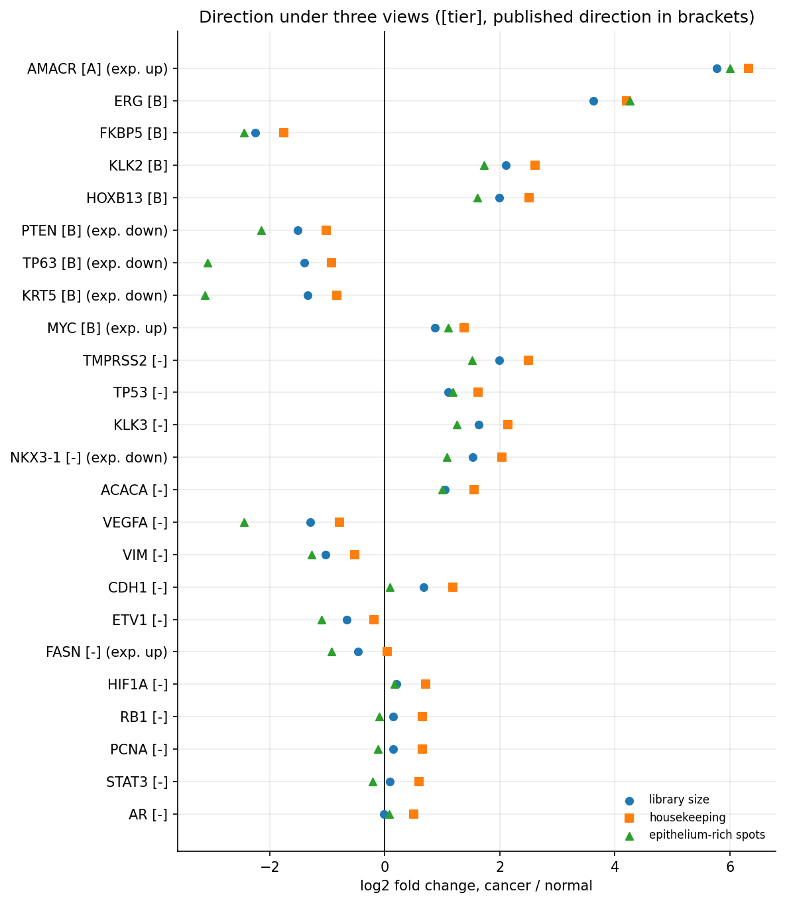
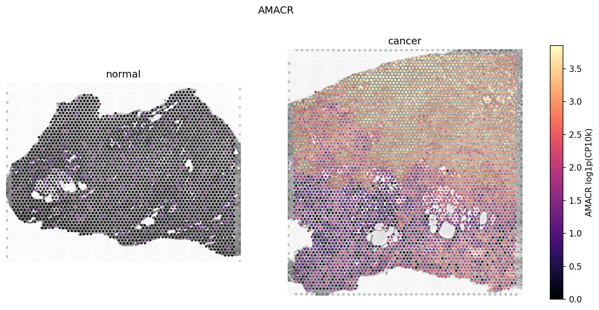

# Prostate Visium candidate markers

An exploratory analysis of one normal and one cancer prostate section profiled with 10x Genomics
Visium (FFPE). We describe both tissues and then put together a short, ranked list of candidate
markers from gene expression (checked against the literature) and H&E morphology. For each
candidate the table records:

- its effect size;
- how its shift compares with the general slide-to-slide shift;
- whether it agrees with the published direction;
- whether its direction holds under alternative normalizations;
- whether it tracks tissue morphology within each slide.

The idea is to use these candidates as pre-specified inputs for testing on multi-patient cohorts.

This project does not train a classifier, make a diagnosis, or claim anything about
generalization or patient-level significance. Spot labels mean slide of origin, not
pathologist-annotated tumor, and the cancer section also contains benign glands.

## Main findings

| Gene | Tier | Change in cancer section | Published direction | Percentile among expression-matched genes | Epithelium-only log2FC |
|---|---|---|---|---|---|
| AMACR | A | up, log2FC 5.8 | up (PMID 11926890) | 99.6 | 6.0 |
| TP63 | B | down, −1.4 | down, basal-cell loss (PMID 12481011) | 93.4 | −3.1 |
| KRT5 | B | down, −1.3 | down, basal-cell loss (PMID 18813120) | 91.3 | −3.1 |
| PTEN | B | down, −1.5 | down (PMID 21878536) | 93.7 | −2.1 |
| MYC | B | up, 0.9 | up (PMID 18567993) | 71.1 | 1.1 |
| ERG | B | up, 3.6 | fusion-positive tumors only (PMID 16254181) | 99.4 | 4.3 |

FKBP5, KLK2 and HOXB13 also reach tier B (beyond background and robust) but have no
cancer-vs-benign reference in the panel. The full table is in
[`results/tables/candidate_markers.csv`](results/tables/candidate_markers.csv) and the tier rules
are in [docs/methods.md](docs/methods.md#tiers).

AMACR is the strongest candidate. It meets all three criteria, and its increase is larger than
that of 99.6% of genes with similar expression.

The basal-cell genes TP63 and KRT5 go down, as published, and the drop roughly doubles when only
epithelium-rich spots are compared. That suggests loss of the basal layer rather than just less
stroma.

The "up" score (AMACR, FASN, MYC) separates the slides better than 99.8% of random 3-gene sets.

The two sections differ in composition. The cancer section has more luminal epithelium, which
pushes every luminal gene up. NKX3-1, which is expected to be lost in cancer, goes up along with
them, though the increase is smaller when only epithelium-rich spots are compared.

Luminal genes follow gland morphology in both sections. NKX3-1, HOXB13, TMPRSS2, KLK2/3 and CDH1
rise with hematoxylin density and gray-level spread (gland lumens) and fall with eosin density.
Since this holds within each slide, it reflects tissue architecture and not slide identity, and
it isn't a cancer signal.

AMACR follows morphology only in the cancer section, where it tracks hematoxylin density
(rho 0.55) and runs against eosin (rho −0.55), i.e. it marks nucleus-dense, stroma-poor regions.
It doesn't do this in the normal section. With this design a cancer-only link can't be separated
from slide identity, so it is something to test on annotated sections.

<p align="center">
  
  
</p>
<p align="center">
  
</p>

## Approach

The pipeline has four stages:

1. `prepare`: check input checksums, filter spots, normalize to CP10k + log1p.
2. `image`: compute per-spot H&E stain density and co-occurrence features from the hires image.
3. `markers`: compute effect sizes for the whole transcriptome, then compare the panel genes
   against the slide background (expression-matched genes and random gene sets), the published
   direction (panel with PMIDs in the config), the direction under housekeeping scaling and in
   epithelium-only spots, and within-slide gene/image correlations. The output is
   `candidate_markers.csv` with tiers A and B.
4. `report`: run notebooks 01-03, which write the figures to `results/figures`.

We didn't train a classifier because with one section per class, a classifier would just learn
to tell the two slides apart (donor, fixation, staining, sequencing depth), and its accuracy
would say nothing about cancer. Instead the analysis asks whether specific named genes shift
more than the slide background, in the direction the literature predicts, and consistently
across normalization choices.

The notebooks go through each step:

1. [`01_data_qc`](notebooks/01_data_qc.ipynb): QC, sequencing depth, tissue composition.
2. [`02_gene_markers`](notebooks/02_gene_markers.ipynb): background, housekeeping check,
   candidate table, set scores, spatial maps.
3. [`03_morphology_concordance`](notebooks/03_morphology_concordance.ipynb): H&E features and
   within-slide concordance.

Details and references are in [docs/methods.md](docs/methods.md).

## Quickstart

Python 3.12. From the repository root:

```bash
python -m pip install -r requirements.txt
python -m pip install -e . --no-deps
python scripts/run_pipeline.py            # all stages, about 2 minutes
python scripts/run_pipeline.py --stage markers   # or a single stage
pytest -q
```

Stages are `prepare`, `image`, `markers` and `report` (`report` executes the notebooks).
`--skip-report` runs everything except the notebooks.

Outputs:

| Path | Tracked | Contents |
|---|---|---|
| `results/tables/` | yes | candidate table, QC summary, housekeeping check, image concordance, random-set reference |
| `results/figures/` | yes | figures saved by the notebooks |
| `results/run_manifest.json` | yes | seed, config hash, git commit, package versions, input checksums |
| `data/processed/` | no | normalized `.h5ad` per slide, per-spot features, all-gene effects |

All parameters, including the seed and the gene panel, are in [`config.yaml`](config.yaml).
Two clean runs produce byte-identical tables and figures.

## Limitations

- There is one section per class, from two donors, so every between-slide difference mixes
  cancer biology with donor, tissue handling, staining and sequencing depth. Spots are not
  independent replicates, so we don't report p-values for between-slide differences.
- Spot labels are slide labels. Visium spots (55 µm) cover several cells, and the cancer section
  contains benign glands and stroma, so "cancer" here means "from the cancer section".
- The sections differ in epithelium/stroma content. Epithelium-only fold changes reduce this
  effect but don't remove it.
- Of the configured housekeeping genes, only ACTB and B2M are in the probe set, and both shift
  between slides. Housekeeping scaling is only used as a sensitivity check.
- Image features come from the hires image (about 14 px per spot). Full-resolution images would
  allow finer morphology.

## Next steps on larger cohorts

1. Fix the tier A/B genes and the up/down set scores from this repository in advance, and don't
   reselect features on the new data.
2. Use many patients per class, with splits grouped by patient (and by slide or batch).
3. Use pathologist-annotated tumor and benign regions so that spot-level labels mean tumor.
4. Apply stain normalization before comparing image features between slides.
5. Test ERG together with a fusion assay (TMPRSS2-ERG), and NKX3-1 within annotated tumor glands.

## Data and attribution

Both datasets are from 10x Genomics and are distributed under
[CC BY 4.0](https://creativecommons.org/licenses/by/4.0/). They are included in `data/`, with
SHA-256 checksums in [`data/CHECKSUMS.sha256`](data/CHECKSUMS.sha256).

- *Normal Human Prostate (FFPE)*, Space Ranger 1.3.0, 10x Genomics (2021).
  <https://www.10xgenomics.com/datasets/normal-human-prostate-ffpe-1-standard-1-3-0>
- *Human Prostate Cancer, Adenocarcinoma with Invasive Carcinoma (FFPE)*, Space Ranger 1.3.0,
  10x Genomics (2021).
  <https://www.10xgenomics.com/datasets/human-prostate-cancer-adenocarcinoma-with-invasive-carcinoma-ffpe-1-standard-1-3-0>

## Repository layout

```
config.yaml              parameters, seed, gene panel with expected directions and PMIDs
data/                    raw 10x inputs and checksums (processed/ is generated, not tracked)
src/prostate_markers/    io, qc, normalize, effects, background, panel, texture, concordance, viz
scripts/run_pipeline.py  entry point
notebooks/               01-03, executed by the report stage
results/                 tables, figures, run manifest
docs/methods.md          methods and references
tests/                   unit tests for the statistical helpers
```

## License

Code is [MIT](LICENSE). Data is CC BY 4.0, 10x Genomics. Citation info is in
[`CITATION.cff`](CITATION.cff).
